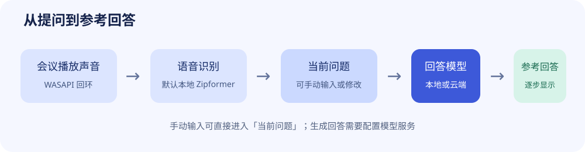
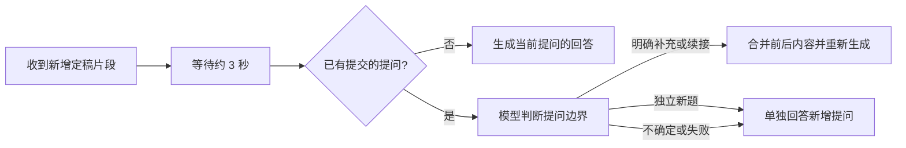
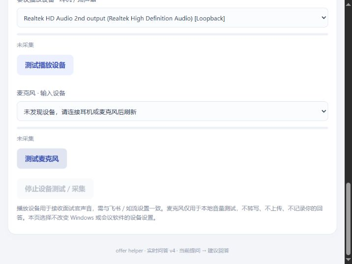

# offer helper

面试提问与参考回答工作台：接收 Windows 会议播放音频，识别面试官提问，再流式生成面试者接下来可以说的建议稿。也支持直接输入问题。

当前是 **Windows 本地 Web 应用原型**，不是已发布的跨平台安装包。问题在上方，参考回答位于页面中间，设备配置位于底部。麦克风仅用于用户主动启动的 5 秒测试录音及回放，不上传、不转写，不记录面试过程中的本人回答。



## 功能与运行方式

| 模式 | 依赖 | 效果 |
| --- | --- | --- |
| 音量与设备测试 | Python 和项目依赖 | 检查播放设备及麦克风，不生成回答 |
| 手动输入 + 本地回答 | 再安装 Ollama 并下载模型 | 本机生成回答，无需云端回答模型 Key |
| 实时语音 + 本地回答 | 下载 Zipformer 模型及 Ollama 回答模型 | 本机语音识别及回答，无云端调用费 |
| 云端回答 | 兼容接口和对应 Key | 问题、个人材料及提问上下文发送到该服务 |

**安装大语言模型不等于安装语音识别。** 当前默认使用 sherpa-onnx + 流式 Zipformer 本地识别，阿里云 Paraformer 保留为可选。下载完成后的本地文字问答不需要云端推理服务。

当前交互支持：在问题输入框按 **Enter** 生成、**Shift+Enter** 换行；语音提问自动生成、补充条件合并、独立追问分题，以及模型辅助补标点。所有回答都通过配置的模型服务生成，已移除固定模板演示。

## 1. 启动项目

1. 安装 Python 3.12，并启用添加到 PATH。
2. 下载并解压项目源码，在项目目录双击 `start.bat`。
3. 首次启动创建 `.venv` 并安装依赖，需要网络。使用自动打开的网页，保持服务窗口运行。

如果首次安装依赖中断，在项目目录打开 PowerShell，执行：

```powershell
.\.venv\Scripts\python.exe -m pip install -r requirements.txt
.\.venv\Scripts\python.exe run.py
```

默认只监听本机，优先使用 `127.0.0.1:8765`，占用时选择后续空闲端口。重复启动会验证并复用本项目服务。不要双击 HTML 文件，也不要继续使用旧项目的网页。

**更新代码后需要真正重启后台。** 先停止采集，关闭原服务窗口（或在该窗口按 Ctrl+C），再运行 `start.bat` 并刷新页面。只刷新网页或再次双击启动脚本，可能仍复用旧后台，造成新版页面调用接口时出现 `Not Found`。

访问令牌保存在 `.local-token`，运行链接保存在 `.runtime.json`，浏览器本地存储保存访问凭据。若提示令牌无效，请重新运行启动脚本，使用新页面。这些文件和带令牌的链接不应公开。

## 2. 安装 Ollama 和本地回答模型

Ollama 是独立的模型运行服务，offer helper 调用其本地接口。当前项目不会自动安装 Ollama 或下载模型。以下操作在 Windows PowerShell 中执行。

### 安装运行服务

从 [Ollama 官方下载页](https://ollama.com/download/windows) 下载并运行安装程序。系统和驱动要求参见 [官方 Windows 文档](https://docs.ollama.com/windows)。安装后重新打开 PowerShell：

```powershell
ollama --version
```

显示版本号表示命令可用。若找不到命令，先关闭旧终端再打开，仍失败时检查安装及 PATH。

### 可选：设置模型存储目录

建议第一次下载前设置；不设置则使用默认目录。下方目录只是示例，可替换为有足够空间的路径：

```powershell
New-Item -ItemType Directory -Force -Path 'F:\OllamaModels'
[Environment]::SetEnvironmentVariable('OLLAMA_MODELS', 'F:\OllamaModels', 'User')
```

设置后退出托盘中的 Ollama，从开始菜单重新启动，并重新打开 PowerShell。此设置不会自动搬迁已下载模型。

### 下载模型

初次体验可使用 `qwen3:4b-instruct`，官方标注下载体积约 2.5 GB。运行需要额外内存，速度取决于硬件、上下文和加载情况；文件大小不等于显存需求。参见 [模型说明与许可证](https://ollama.com/library/qwen3:4b-instruct)。

```powershell
ollama pull qwen3:4b-instruct
ollama list
```

等待下载完成，确认列表包含完整模型名称。模型存储在 Ollama 目录，不需要放入本项目或上传 GitHub。

### 测试模型并检查服务

```powershell
ollama run qwen3:4b-instruct
```

在交互提示符输入：`请用适合面试口述的方式，简短解释什么是世界模型。`

看到回答后，输入 `/bye` 退出命令行对话。退出对话不等于停止后台服务。检查已加载模型及服务：

```powershell
ollama ps
Invoke-RestMethod -Uri 'http://localhost:11434/api/tags'
```

若服务无法连接，先从开始菜单启动 Ollama；也可执行 `ollama serve` 并保持终端运行。若提示端口已占用，先检查服务是否已运行，不要重复启动。

### 接入 offer helper


在「回答模型设置」填写：

| 设置项 | 值 |
| --- | --- |
| 模型名称 | `qwen3:4b-instruct` |
| 接口基础地址 | `http://localhost:11434/v1` |
| API Key | `ollama` |

`ollama` 是满足本项目非空校验的占位值，不需要购买。本地 Ollama 忽略该值，参见 [官方兼容接口说明](https://docs.ollama.com/api/openai-compatibility)。不要填其他供应商的真实 Key。

1. 需要重启后保留配置时，勾选「保存到本机」，不要勾选「清空密钥」。
2. 点击「保存模型设置」，确认当前模型提示更新；只修改输入框不会生效。
3. 输入问题，按 Enter 或点击「生成建议回答」。

日常保持 Ollama 后台运行，再启动本项目即可，不需要重复下载或保持命令行对话窗口。首次加载可能较慢，可先运行一次模型预热。更换模型时先下载，再将模型名称改为 `ollama list` 中的完整名称并保存。

## 3. 语音识别与设备配置

### 默认：本地 Zipformer

首次双击 `download-asr.bat`，会安装依赖并从 sherpa-onnx 官方 GitHub Release 下载中英双语流式模型。压缩包包含不同精度版本，下载为数百 MB，请预留约 2 GB 空间。下载中断可重新执行；当前不支持断点续传。模型及压缩包保存在项目 `models/`，不提交 GitHub。

完成后重启服务，页面应显示「本地 Zipformer · 就绪」，选择会议播放设备后开始听取提问。无需阿里云 Key，音频不上传。使用 CPU、2 个推理线程；输入设备采样率由 sherpa-onnx 流式重采样到模型的 16 kHz。模型使用 int8 编码器和 joiner，以及 fp32 decoder。

默认模型为 `sherpa-onnx-streaming-zipformer-bilingual-zh-en-2023-02-20`。来源、文件说明及测试音频见 [官方模型文档](https://k2-fsa.github.io/sherpa/onnx/pretrained_models/online-transducer/zipformer-transducer-models.html#csukuangfj-sherpa-onnx-streaming-zipformer-bilingual-zh-en-2023-02-20-bilingual-chinese-english)。分发模型前应核对其权重许可证，不将框架许可证等同于所有权重许可证。

可选 `.env` 设置：`ASR_BACKEND=sherpa`；`SHERPA_MODEL_DIR` 可指定同结构的模型目录，留空使用默认路径。修改后重启。该路径不是任意 ASR 模型的通用加载入口，其他 Zipformer 文件名或架构需要适配。

识别过程中显示草稿，检测到约 1.2 秒尾部静音后定稿；无语音静音阈值为 2.4 秒，连续段最长约 30 秒。停止时丢弃未定稿片段，避免停止后误触发回答。

### 自动回答与提问边界

最后一个语音片段定稿约 **3 秒** 后尝试生成回答；期间收到新的识别事件会重新等待。这个时间用于触发生成，不代表面试官已经说完。长停顿不会直接清空当前提问的前半段。

已有提交后收到新增片段时，使用当前回答模型判断是否应分题，并参考识别片段间隔：

| 原提问 | 新增内容 | 期望处理 |
| --- | --- | --- |
| 如何设计缓存？ | 还有一个限制，内存只有一百兆 | 补充条件，合并后重新生成 |
| 如果请求量…… | 突然翻了十倍，你怎么办？ | 续接未完句子，合并后重新生成 |
| 如何设计缓存？ | 那缓存击穿怎么解决？ | 独立追问，作为新题 |
| 介绍你的项目 | 你负责哪部分？ | 同主题的新题，单独回答 |
| 任意前题 | 好的，下一题…… | 开始新题 |

这些是判断提示中的目标行为，不是固定规则保证的识别结果。判断不确定、超时或接口不可用时，新增内容单独生成回答，前题保留在历史中帮助理解指代，不强行拼接两题。更新期间又收到新语音时，过期的判断结果不会触发生成。



**当前只接收会议播放声音，不接收面试者实际回答。** 因此系统无法确认你是否回答完，停顿也不能准确代表题目边界。首次提交前的片段会先合并；分题判断、模型能力和识别错字都可能影响结果，需要结合实际面试语音测评。建议只保留一个活动问答页面，避免重复触发。

### 标点恢复

语音来源的问题在生成前会尝试用当前模型补标点。当前实现跳过少于 12 个字符或已包含句末标点的问题；手动编辑后的问题直接使用编辑结果。补标点结果会校验去掉标点和空白后的字词是否一致；字词变化或请求失败时保留原文。整理结果会回显到未被继续编辑的问题框，原始识别片段仍保留在会话历史中。

分题判断和补标点可能分别增加一次模型请求，使用云端模型时也会增加调用费用。分题请求读取超时为 15 秒，补标点为 20 秒，回答流为 60 秒；这些是请求超时设置，不是实际响应时间保证。补标点不能修正识别错词，也不保证每个标点位置都正确。

### 可选：阿里云 Paraformer

如需恢复云端识别，设置 `ASR_BACKEND=dashscope` 并配置下列语音凭据。只有该模式会将播放音频发送至阿里云。

复制 `.env.example` 为 `.env`，填写自己的配置并重启应用：

| 变量 | 用途 |
| --- | --- |
| `DASHSCOPE_API_KEY` | 阿里云百炼语音识别凭据 |
| `ASR_MODEL` | 默认 `paraformer-realtime-v2` |
| `ASR_WS_URL` | 语音接口地址，需匹配账号地域 |
| `LLM_BASE_URL` | 回答模型兼容接口基础地址 |
| `LLM_API_KEY` | 回答模型凭据；未设置时回退到 `DASHSCOPE_API_KEY` |
| `LLM_MODEL` | 回答模型名称，默认 `qwen-plus` |

回答模型可在页面切换，无需重启。相同地址下 Key 留空会保留旧值，更换地址不会沿用旧服务的 Key。持久化设置写入 `.model-settings.json`，启动时优先于 `.env`；仅修改 `.env` 可能被已有保存设置覆盖。生成过程中不可切换模型。

底部选择的播放设备应与飞书 / 如流扬声器设置一致。先测试音量，再开始听取提问。点击测试播放设备会通过所选设备播放两声提示音。点击「录音 5 秒」后说话，页面显示音量和倒计时；完成后点击「播放录音」，通过左侧所选播放设备试听。录音只保存在本机内存，重新录音、清空会话或关闭服务会清除；可随时停止测试。测试期间不能同时采集会议声音。麦克风不参与实时转写；没有麦克风也能识别播放声音。选择设备只影响本应用，不改变会议软件或系统设置。



> 上图为旧版设备区域截图，仅用于定位控件；以当前运行界面为准。

当前采用 WASAPI 播放回环，同一设备的音乐、通知及所有远端人员声音也会被采集，尚未按进程或声纹隔离。切换设备后请停止、刷新并重新选择。刷新网页不会自动停止采集，应点击停止按钮或关闭服务进程。

开启自动回答后，最后一个语音片段定稿约 3 秒后触发生成；这依赖停顿，并非完整语义提问检测。问题未说完时可编辑后重新生成。在问题输入框按 Enter 或点击按钮可手动生成；Shift+Enter 可换行。建议只保留一个活动页面，避免多个页面重复触发。

## 4. 常见问题

| 现象 | 排查方法 |
| --- | --- |
| 模型没有变化 | 点击保存，查看已保存模型提示 |
| `Not Found` / 新功能没有生效 | 关闭旧后台服务，再运行 `start.bat` 并刷新；重复启动会复用旧进程 |
| 补充提问被分成新题 / 两题误合并 | 检查识别文字及当前模型的分题结果；系统未采集你的回答，不能仅靠停顿判断边界 |
| 停顿后迟迟没有更新回答 | 检查是否持续收到新草稿、自动回答是否开启，以及分题和补标点的模型调用是否仍在等待 |
| 本地接口连接失败 | 检查 Ollama 后台服务及 `/api/tags`，端口为 11434 |
| 找不到模型 | 用 `ollama list` 检查名称，下载并填写完整名称 |
| 本地模式提示缺少 Key | 填入占位值 `ollama` 并保存 |
| 回答慢或超时 | 先用 `ollama run` 检查加载和推理，查看 `ollama ps`，缩短材料或改用更小模型；当前请求读取超时为 60 秒 |
| 能文字回答但不能转写 | 运行 download-asr.bat 安装 Zipformer；Ollama 不负责语音识别 |
| 按钮灰色 / 连接断开 | 保持后端运行，使用启动脚本打开的页面或点击重新连接 |
| 没有麦克风设备 | 检查 Windows 输入设备并刷新；不影响播放侧采集 |

## 5. 手机配对显示（已实现）


电脑负责会议采集、语音识别和模型调用；手机仅显示当前提问和参考回答，不使用手机麦克风。电脑外放或戴耳机均不改变这套采集方式。当前提供手机浏览器页面，还不是 Android / iOS 安装包。

1. 电脑和手机连接同一可信局域网。电脑可以接网线，手机连接同一路由器的 Wi-Fi。
2. 在电脑启动项目，配置模型及播放设备；保持电脑服务和问答页面开启。目前自动生成仍由电脑页面触发。
3. 页面底部找到「手机配对显示」，点击「开启 / 重新生成配对码」。出现多个地址时，用 `ipconfig` 确认实际 Wi-Fi / 有线网卡 IPv4，避免选择 VPN 或虚拟网卡。
4. 手机用系统相机或扫码工具扫描对应二维码，在系统浏览器中打开。也可以复制完整配对链接到手机浏览器。链接 5 分钟有效、只能使用一次，不要分享给其他人。
5. 服务使用本机自签名 HTTPS 证书，首次连接可能提示证书未受信任。核对地址属于自己的电脑，并核对电脑页面显示的 SHA-256 证书指纹；确认无误后由用户自行决定是否信任。无法查看或核对证书时先停止连接，不要关闭浏览器安全检查。当前尚未提供系统信任证书的自动安装流程。
6. Windows 防火墙如果提示，按需允许 Python 在专用网络通信，不要关闭整个防火墙。访客 Wi-Fi、AP 隔离、VPN 或防火墙阻拦会导致连接失败。
7. 电脑开始听取提问或手动生成回答，手机约每 0.7 秒同步一次，显示逐步生成的文字。手机休眠会暂停更新，唤醒后自动恢复；出现断线可点击重新连接。
8. 使用后在电脑点击「撤销配对并关闭」，终止手机连接和局域网监听。手机「退出配对」只清除此标签页的凭据；需要彻底撤销时使用电脑按钮。

电脑控制服务仍仅监听本机。开启手机配对后另建只读 HTTPS 服务，使用随机端口；手机不能修改密钥、模型或控制录音。一次只允许一部手机的配对凭据，新手机配对成功会撤销旧手机；凭据最长有效 12 小时，电脑重启后失效。重新生成二维码只替换待使用链接，不立即踢出当前手机。TLS 证书在重新开启服务时生成，换网后应关闭并重新开启配对。

`.mobile-tls/` 保存本机证书与私钥，已被 Git 忽略。二维码在本机生成，不发给第三方二维码服务。手机仅接收当前问题、当前回答、对应问题及必要状态，不接收原始音频、个人材料或模型密钥。局域网跨设备访问仍需在实际手机及网络上验证。

后续规划：Windows 安装包、软件内 Ollama 安装与模型下载向导，以及更便捷的证书信任流程。手机独立监听混合声音不属于当前模式；下载完成后，本地 ASR 配合 Ollama 可实现离线语音问答。

## 6. 数据与 GitHub 发布准备

原始音频不落盘，麦克风音量测试不上传。默认本地转写不上传音频；仅选择 dashscope 模式时上传播放音频。真实回答会发送当前问题、个人材料及最多 40 条已定稿提问至模型接口；使用本机 Ollama 时目的地为本机。

分题判断还会向同一模型接口发送前题、新增语音文字和近似片段间隔；补标点会发送待整理的提问文本。选择云端回答模型时，这些文字同样会发送到云端，即使语音识别使用本地 Zipformer。

会话在后端内存中最多保留 200 条字幕，重启清空；个人材料在当前页面，刷新丢失。模型配置持久化文件含明文凭据，不应公开。云服务费用及数据规则由对应供应商决定。

发布前：

- 提交源码、README、依赖清单和空凭据的 `.env.example`。
- 不提交 `.env`、`.model-settings.json`、`.local-token`、`.runtime.json`、虚拟环境、日志、模型权重和含个人信息的截图。`.gitignore` 已包含本机配置及常见模型文件排除规则。
- 检查待提交差异和历史；忽略规则不能移除已经追踪的敏感文件。
- 确定项目许可证并添加 `LICENSE`。目前尚未选定许可证，不能把公开可读等同于已获得开源使用授权；第三方依赖及模型保留各自许可证。
- 安装包通过 Releases 分发，模型从官方来源下载，不提交至源码仓库。

本地 Git 配置的远端仓库为 [Weiqiang-Jin/Offer-Helper](https://github.com/Weiqiang-Jin/Offer-Helper)。本地修改需提交并推送后才会出现在远端；仓库地址不代表已发布安装包或 Release。

## 7. 开发与验证

```powershell
.\.venv\Scripts\python.exe -m pip install pytest
.\.venv\Scripts\python.exe -m pytest -q
```

前端流程测试使用 Node.js 自带的测试运行器，无需安装 npm 依赖：

```powershell
node --test tests/test_question_flow.cjs
node --check web/app.js
```

测试覆盖鉴权、会话隔离、模型回答事件、取消、混音、模型配置、麦克风本地测试、标点字词保留、分题失败回退、过期结果丢弃和新增提问处理等。分题测试使用模拟模型返回值，验证程序分支，不能代表实际模型的语义分题准确率。自动化测试不代表真实会议、真实模型或响应时延已经验证。`requirements-lock.txt` 是已记录的开发环境依赖快照。

主要文件：`run.py` / `start.bat` 为入口；`interview/audio.py` 负责音频；`interview/answers.py` 负责提示及流式回答；`interview/settings.py` 负责模型配置；`interview/app.py` 提供本地服务；`web/` 是无需构建的页面。

尚未实现：会议进程隔离、简历文件解析、语音服务自动重连、完整语义提问检测以及桌面安装包和模型部署向导。
